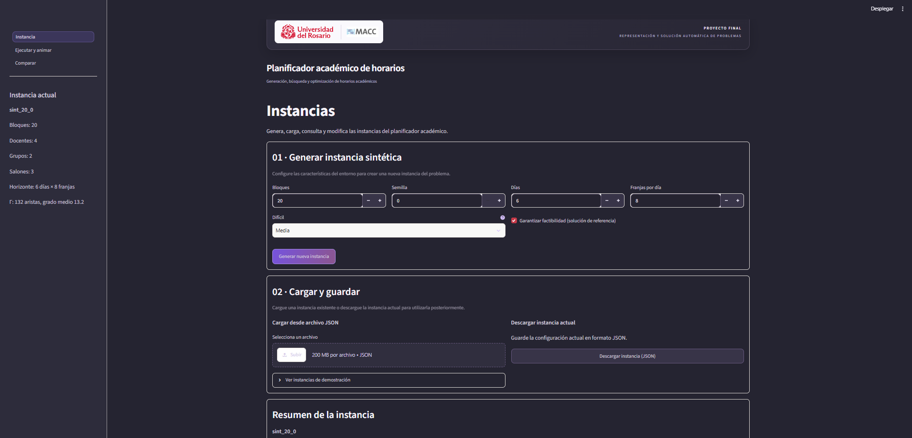
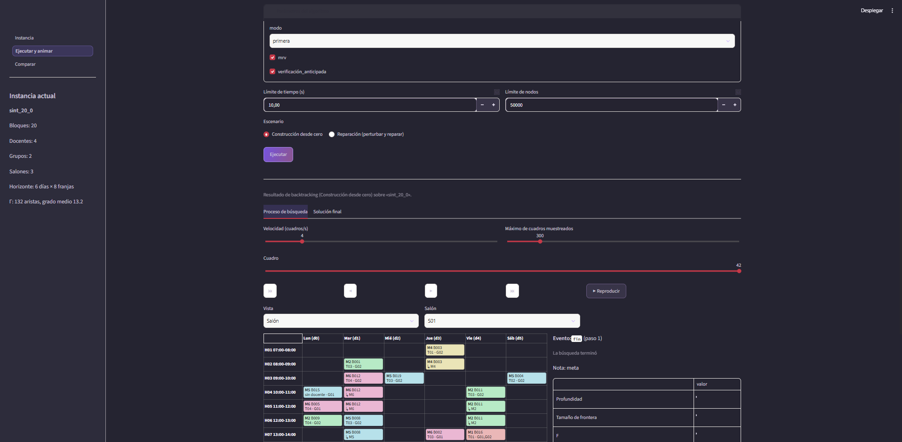
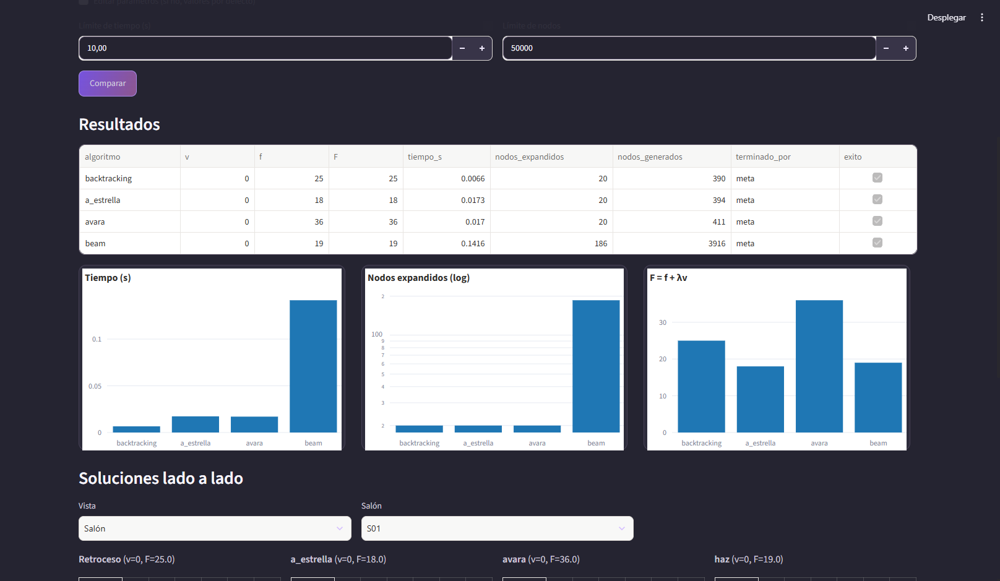

# Agente planificador de horarios

Agente que genera horarios sin cruces para un programa académico. Parte de la asignación de bloques de clase a franjas, días y salones, y busca una solución factible de costo mínimo (o lo más cercana posible) con distintos algoritmos de búsqueda.

Proyecto del curso *Representación y solución automática de problemas*, Universidad del Rosario.

Autores: Manuel Cruz y Santiago Peña.

## Formalización

- **Estado.** Una asignación parcial X: cada bloque m ocupa una posición (día, franja de inicio, salón). U(X) es el conjunto de bloques sin ubicar.
- **Ocupación.** Un bloque de duración δ ocupa δ franjas consecutivas del mismo día y del mismo salón.
- **Acciones.** Añadir(m, p), Eliminar(m), Intercambiar(m, m'), Reubicar(m, p) y CambiarSalón(m, s).
- **Restricciones duras de legalidad.** El bloque debe caber en la jornada. Un bloque virtual solo va en un salón virtual, y un bloque presencial no va en uno. En un salón presencial deben cumplirse tipo y capacidad (≥ estudiantes del bloque) y las celdas deben estar libres. Los salones virtuales no tienen límite de capacidad ni de ocupación simultánea.
- **Restricciones de solución (v(X) = 0).** Disponibilidad del docente, ventana de matrícula del grupo y ningún traslape entre bloques vecinos en el grafo de conflictos Γ (comparten docente o algún grupo). El generador de acciones no filtra estas tres; se cuentan como violaciones en v(X). Los solvers sí las usan para podar el dominio de cada bloque.
- **Objetivo blando.** f(X) = Σ wᵢ·φᵢ(X): huecos de docentes y grupos, dispersión de docentes, carga diaria, horas extremas y cambios de sede.
- **Costo total.** F(X) = f(X) + λ·v(X), con λ = `pesos.lam` o, por defecto, una cota superior de f + 1, para que una violación pese más que cualquier mejora posible en f.

## Algoritmos

| Algoritmo | Clave o configuración | Descripción |
|---|---|---|
| Backtracking (CSP) | `backtracking` | Backtracking (CSP) con MRV + grado y forward checking. Modos `primera` y `optimizar`. |
| DFS sin heurísticas | `backtracking` (configuración `dfs_no_informada`) | Variante de Backtracking sin MRV ni forward checking, con orden natural de variables y valores y sin permitir saltar bloques. |
| A* | `a_estrella` | A* con heurística admisible y consistente: óptimo respecto del costo aditivo g (no incluye huecos, dispersión ni cambio de sede). |
| Avara | `avara` | Búsqueda avara: heurística de distancia a la meta (no admisible). |
| Beam search | `beam` | Beam search: conserva los k mejores nodos por nivel (g + h). |
| Reparación | `reparar()` en `planificador/algoritmos/reparacion.py` | Repara un horario vigente tras un cambio de disponibilidad, buscando una solución factible cercana a la original. |

Las claves de los algoritmos son las definidas en `planificador/algoritmos/registro.py` (`REGISTRO`), que usan la interfaz y los experimentos. `dfs_no_informada` es una etiqueta de configuración experimental que utiliza el solver `backtracking` con parámetros sin heurísticas.

## Estructura

```text
.
├── README.md
├── requirements.txt        dependencias con versión fijada
├── pytest.ini              configuración de pytest
├── setup.cfg               configuración de flake8 (líneas de 88 caracteres)
├── .gitignore              excluye .venv/, salidas/ y los datos reales
├── docs/
│   └── contrato.md         reglas de desarrollo y firmas congeladas de la API
├── notebooks/
│   └── demostracion_planificador.ipynb
├── planificador/
│   ├── core/               modelo (entidades y acciones), estado, acciones,
│   │                       conflictos (Γ), costo (v, f, F) y validador independiente
│   ├── algoritmos/         base (interfaz Solver), comun, backtracking,
│   │                       informada (A* y avara), beam, reparacion,
│   │                       registro y reproduccion (cuadros de animación)
│   ├── io_datos/           esquema (formato de entrada), plantilla (genera el
│   │                       Excel de entrada) y sintetico (instancias de prueba)
│   ├── experimentos/       runner (ejecuta configuraciones), graficas (PNG y
│   │                       tabla resumen) y configs/ (rapido, base, beam_ancho)
│   └── app/                interfaz Streamlit: main (navegación), páginas
│                           pagina_instancia, pagina_ejecutar y pagina_comparar,
│                           y módulos sin Streamlit (vistas, edicion, ejecucion, graficas)
├── herramientas/
│   └── auditoria_horas.py  auditoría de horas: calendario académico vs. malla (solo lectura)
├── tests/                  pruebas con pytest (fixtures en tests/fixtures/)
└── salidas/                resultados generados (no se versiona)
```

## Instalación

El proyecto requiere Python 3.12.

Los siguientes pasos están diseñados para Windows utilizando PowerShell.

### 1. Crear el entorno virtual

Desde la raíz del repositorio, ejecuta:

```powershell
py -3.12 -m venv .venv
```

### 2. Activar el entorno virtual

```powershell
.\.venv\Scripts\Activate.ps1
```

### 3. Instalar las dependencias

Con el entorno virtual activado, ejecuta:

```powershell
python -m pip install -r requirements.txt
```

### 4. Verificar la instalación

Para comprobar que Python está utilizando la versión requerida:

```powershell
python --version
```

Para verificar que las dependencias se instalaron correctamente:

```powershell
python -m pip list
```

Una vez completados estos pasos, el entorno estará preparado para ejecutar la aplicación, los algoritmos y los experimentos del proyecto.

**Importante:** Los comandos de las siguientes secciones deben ejecutarse desde la raíz del repositorio, con el entorno virtual activado.

## Uso

Todos los comandos se ejecutan desde la raíz del repositorio. Los módulos de `planificador/` se invocan con `-m`, para que encuentren el paquete.

### Interfaz

Para iniciar la aplicación:

```powershell
python -m streamlit run planificador/app/main.py
```

La interfaz cuenta con las siguientes secciones:

- **Instancia**: genera una instancia sintética, la carga, la edita y la guarda.
- **Ejecutar y animar**: corre un algoritmo sobre la instancia y reproduce su búsqueda paso a paso.
- **Comparar**: ejecuta varios algoritmos sobre la misma instancia y compara sus resultados.

### Experimentos

Para ejecutar los experimentos se utilizan los archivos de configuración disponibles en `planificador/experimentos/configs/`.

**Corrida rápida:**

```powershell
python -m planificador.experimentos.runner --config planificador/experimentos/configs/rapido.json
```

**Experimentos base:**

```powershell
python -m planificador.experimentos.runner --config planificador/experimentos/configs/base.json
```

**Barrido del ancho de Beam Search:**

```powershell
python -m planificador.experimentos.runner --config planificador/experimentos/configs/beam_ancho.json
```

**Generación de gráficas y tablas:**

```powershell
python -m planificador.experimentos.graficas --csv salidas/experimentos/rapido/resultados.csv
```

Las configuraciones tienen los siguientes propósitos:

- `rapido.json`: corrida corta de comprobación (una semilla, un tamaño).
- `base.json`: malla de comparación con varias semillas, tamaños, dificultades, escenarios y algoritmos. Es una corrida larga.
- `beam_ancho.json`: barrido del ancho k del beam search.
- `graficas`: genera los PNG y `tabla_resumen.md` en la carpeta del CSV indicado (o en la de `--salida`). Para otra configuración, cambie la ruta de `--csv` por la de su `resultados.csv`.

El runner escribe en `salidas/experimentos/<nombre>/` los archivos `resultados.csv` y `metadata.json`. Ejecutarlo de nuevo sobrescribe esa carpeta; use `--salida` para escribir en otra ubicación.

#### Experimentos completos realizados

Para el análisis experimental del proyecto se ejecutó la configuración `base.json` con la siguiente ruta de salida:

```powershell
python -m planificador.experimentos.runner --config planificador/experimentos/configs/base.json --salida salidas/experimentos/base_completo
```

Esta ejecución generó un archivo `resultados.csv` con 300 registros.

Posteriormente, se generaron las gráficas y tablas de resumen:

```powershell
python -m planificador.experimentos.graficas --csv salidas/experimentos/base_completo/resultados.csv --salida salidas/experimentos/base_completo/analisis
```

Los resultados se almacenan en `salidas/experimentos/base_completo/` y el análisis gráfico en la subcarpeta `analisis`.

La cantidad de ejecuciones por algoritmo puede variar debido a los límites de tamaño `max_n` definidos en la configuración. Una ejecución omitida por ese límite no debe interpretarse como un fallo del algoritmo.

### Generar una instancia sintética

Para generar una instancia sintética de 50 bloques con semilla 0:

```powershell
python -m planificador.io_datos.sintetico --bloques 50 --semilla 0
```

Opciones: `--bloques` (número de bloques), `--semilla` y `--salida` (ruta del JSON). Por defecto guarda en `salidas/instancias/`. La instancia incluye una solución oculta que sirve de referencia.

### Plantilla de entrada

Para generar el libro Excel de entrada:

```powershell
python -m planificador.io_datos.plantilla
```

Para generarlo sin filas de ejemplo:

```powershell
python -m planificador.io_datos.plantilla --sin-ejemplos
```

Genera el libro Excel de entrada a partir de `planificador/io_datos/esquema.py`. Por defecto guarda en `salidas/plantilla_entrada_BORRADOR.xlsx`. Con `--sin-ejemplos` no incluye filas de ejemplo. Opción adicional: `--salida`.

### Auditoría de horas

Para ejecutar la auditoría:

```powershell
python herramientas/auditoria_horas.py
```

Compara las horas programadas en el calendario académico con las que exige la malla curricular, y genera `salidas/auditoria_horas.xlsx`. Es una herramienta de solo lectura.

Requiere los Excel originales de la malla curricular y del calendario académico. Esos archivos contienen datos personales y no se versionan. Use `--malla` y `--calendario` para indicar sus rutas, y `--hojas` para elegir las hojas del calendario que se auditan.

### Pruebas y estilo

Para ejecutar las pruebas:

```powershell
python -m pytest
```

Para revisar el estilo del código:

```powershell
python -m flake8
```

Algunas pruebas están marcadas como `integracion` y se omiten si no existen los Excel reales.

## Reproducibilidad

- Las configuraciones de `planificador/experimentos/configs/` fijan las semillas (`"semillas"`). El generador sintético recibe la semilla con `--semilla`.
- Los solvers son deterministas: con los mismos datos y parámetros dan el mismo resultado.
- Cada corrida del runner guarda en `metadata.json` la configuración, las versiones de Python y de las librerías, y la fecha. Con esto se puede repetir el experimento.
- Las columnas de tiempo (`tiempo_s`) dependen del reloj de la máquina y no son reproducibles. El resto de columnas sí lo son.
- `salidas/` está excluido de git (`.gitignore`), igual que los datos reales.

## Capturas de pantalla

### 1. Generación y edición de instancias

La interfaz permite generar instancias sintéticas, cargar archivos JSON, consultar sus características y modificar sus componentes.



### 2. Ejecución y animación

La aplicación permite ejecutar los algoritmos de búsqueda, visualizar el proceso de exploración y observar la solución final mediante controles de reproducción paso a paso.



### 3. Comparación de algoritmos

Se comparan diferentes algoritmos sobre una misma instancia mediante métricas de rendimiento, tablas de resultados, gráficas y visualización de horarios.



## Estado del proyecto

- **Sprints 1 a 4 completos**: estructura del proyecto, esquema de entrada, núcleo del planificador, representación de estados, acciones, restricciones, función de costo, validador, algoritmos de búsqueda, reparación, experimentos e interfaz gráfica.
- **Notebook de demostración completo**: generación de instancias, consulta de atributos y métodos, serialización, representación de estados, aplicación de acciones y ejemplos de ejecución de algoritmos.
- **Experimentos realizados**: ejecución de la configuración base, generación de resultados y elaboración de gráficas y tablas comparativas.

### Funcionalidades pendientes o futuras

- Importador de la plantilla de entrada.
- Importadores de los Excel reales.
- Exportador del cronograma oficial.
- Q-learning (opcional).

## Uso de IA

Partes del código se desarrollaron con asistencia de IA y fueron revisadas por los autores, que deben poder explicarlas en la sustentación.
